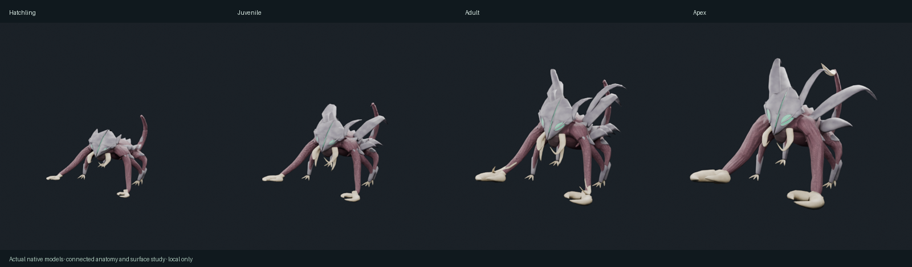

# Evolving eyes and scorpion pincers

2026-10-18. User-requested refinement of the connected lineage study. User approved this pass for release. These GLBs are now the default game models; gameplay and saves are unchanged. Earlier studies remain preserved locally.

Review: http://localhost:5201/tools/creature-review.html?lineageStudy=2

Walking previews remain available in the local art workspace.

All four stages now have convex mint sensory eyes seated in shaped sockets. Their surface extent increases at each stage, rather than retaining tiny slits. Forearm hooks become two opposing curved scorpion fingers sharing an overlapping wrist/palm root. Template pincer sizes progress through 0.52, 0.72, 0.94 and 1.16 before the original stage proportions are applied. Hatchling has small graspers; Apex has the fullest palms and hooked fingers. Existing head horns, low back blades, mandibles and tail spike remain.

| Stage | Export triangles | Bones / sockets / clips |
|---|---:|---|
| Hatchling | 7,600 | 27 / 8 / 6 |
| Juvenile | 11,596 | 27 / 8 / 6 |
| Adult | 11,596 | 27 / 8 / 6 |
| Apex | 11,596 | 27 / 8 / 6 |

Editable native sources, GLBs, maps, stills, walking frames and measured reports are stored per stage. Anatomy sources are separately retained in `../feature-anatomy/`. Rebuild with `refine_apex_anatomy.py -- --stage <stage> --features`, `validate_apex_study.py -- --stage <stage> --features --clean-islands`, `refine_apex_surfaces.py -- --stage <stage> --features`, then `validate_apex_study.py -- --stage <stage> --features --surface`.

Validated one connected tissue component and no unweighted vertices per stage; normalized weights, original bone rest matrices, correct foot-side bindings, six clips and eight sockets. Exported sensory surface area increases by at least 15% per evolution. All 41 creature tests, typecheck and production build pass. Native idle/move/capture loop closure passes below 1e-5 matrix error. Desktop and phone-width preview checked; physical-device performance remains unverified.

Pincers follow the existing forearm bones; separately opening/closing fingers are not newly animated. Further concept fidelity and deformation polish remain open. Release checks and deployment status are recorded below.

Release preparation: promoted the approved exports to public/models, made native texture paths relative and compressed the editable sources. Final integration with remote main: all 581 tests passed; typecheck and production build passed. User authorized publishing to main. Physical-device performance remains unverified.
